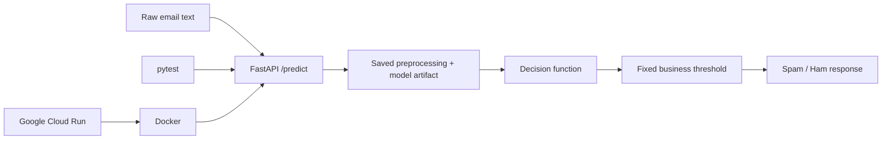

<div align="center">

# 📧 Email Spam Classification

### Leakage-safe NLP classification — from raw email text to a deployable API

[](https://www.python.org/)
[](Email_Spam_Classification.ipynb)
[](https://scikit-learn.org/)
[](Email_Spam/deployment/app.py)
[](Email_Spam/deployment/Dockerfile)
[](Email_Spam/deployment/DEPLOYMENT.md)

**Locked-test F1: 0.9828 · ROC-AUC: 0.9996 · PR-AUC: 0.9988**

An end-to-end Machine Learning project that turns raw email text into reliable spam predictions while explicitly controlling data leakage, false positives, and deployment reproducibility.

</div>

---

## 📑 Table of contents

- [Business problem](#-business-problem)
- [Recruiter snapshot](#-recruiter-snapshot)
- [Project workflow](#-project-workflow)
- [Dataset and split strategy](#-dataset-and-split-strategy)
- [Exploratory analysis and hypotheses](#-exploratory-analysis-and-hypotheses)
- [Text processing and Feature Engineering](#-text-processing-and-feature-engineering)
- [Feature selection and modeling](#-feature-selection-and-modeling)
- [Threshold strategy](#-threshold-strategy)
- [Final results](#-final-results)
- [Error analysis](#-error-analysis)
- [Deployment architecture](#-deployment-architecture)
- [Repository structure](#-repository-structure)
- [How to run](#-how-to-run)
- [API usage](#-api-usage)
- [Limitations and next steps](#-limitations-and-next-steps)

---

## 🎯 Business problem

The goal is to classify an incoming email as:

- `0` — legitimate email (`ham`);
- `1` — spam.

This is not only an accuracy problem. A **false positive** can hide an important legitimate message, while a **false negative** allows spam into the inbox. The project therefore uses PR-AUC, precision, recall, F1, explicit error analysis, and validation-based threshold selection—not accuracy alone.

> **Modeling objective:** maximize spam detection while maintaining validation precision of at least **0.99**.

---

## 💼 Recruiter snapshot

This project demonstrates the ability to:

- design a complete NLP/ML experiment rather than train a single model;
- prevent duplicate-text leakage before exploratory analysis and model selection;
- convert raw unstructured text into sparse numerical features;
- compare representations, selectors, algorithms, ensembles, and hyperparameters empirically;
- choose a decision threshold from business costs instead of accepting `0.5` automatically;
- validate once on a genuinely locked final test set;
- investigate individual model errors and explain why they occurred;
- package preprocessing and inference into one reusable artifact;
- expose the model through a tested FastAPI service and Docker image.

---

## 🧭 Project workflow

```mermaid
flowchart LR
    A[Raw emails] --> B[Group-aware locked split]
    B --> C[EDA and hypotheses]
    C --> D[Text normalization]
    D --> E[TF-IDF Feature Engineering]
    E --> F[Feature selection]
    F --> G[Model comparison]
    G --> H[Hyperparameter tuning]
    H --> I[Threshold selection]
    I --> J[Locked final test]
    J --> K[Error analysis]
    K --> L[FastAPI + Docker + Cloud Run]
```



The final test is separated **before** analysis. All representation, feature-selection, model, tuning, and threshold decisions are made using development data only.

---

## 📊 Dataset and split strategy

The dataset contains **5,728 labeled English emails**:

| Column | Description |
|---|---|
| `text` | Raw email subject and body |
| `spam` | Target: `1` for spam, `0` for legitimate email |

- Spam share: approximately **23.9%**.
- Locked final test after deduplication: **825 emails**.
- Normalized overlap between development and final test: **0 emails**.

Before splitting, every email receives a normalized grouping key. URLs, email addresses, numbers, money values, HTML, punctuation, and letter case are normalized only to identify equivalent messages. All copies of the same normalized message remain in one split, which prevents memorization from inflating final metrics.

Dataset reference: [MIT OpenCourseWare — Text Analytics Assignment](https://ocw.mit.edu/courses/15-071-the-analytics-edge-spring-2017/pages/text-analytics/assignment-5/)

---

## 🔎 Exploratory analysis and hypotheses

The analysis examined whether spam and legitimate email differ in:

- text length and its highly skewed distribution;
- frequent words and word combinations;
- URLs, email addresses, money values, and digits;
- calls to action such as *click*, *buy*, or *subscribe*;
- exclamation and question marks;
- noisy spelling and obfuscated tokens such as `fr33` or `cl1ck`.

The hypotheses informed later feature engineering. They were not treated as causal proof: plots, class-level statistics, and statistical tests were used to determine whether an observed pattern was stable enough to investigate further.

---

## 🧹 Text processing and Feature Engineering

The cleaning strategy preserves useful language while standardizing technical noise:

- HTML → `html` token;
- email addresses → `email` token;
- URLs → `url` token;
- currency amounts → `money` token;
- remaining numbers → `number` token;
- repeated whitespace and technical formatting → normalized text.

Several representations were compared empirically:

| Representation | What it captures |
|---|---|
| CountVectorizer | Raw word occurrence counts |
| Word TF-IDF | Important words and word n-grams |
| Character TF-IDF | Misspellings, obfuscation, prefixes, and suffixes |
| Combined word + character TF-IDF | Semantic vocabulary plus noisy spelling patterns |

The combined representation was retained because it captures both normal language and common spam obfuscation.

Outlier-related alternatives—raw counts, scaling, `log1p`, Yeo–Johnson, clipping, and quantile binning—were also compared. Removing very long or symbol-heavy messages did not improve validation quality, so valid rare emails were preserved.

---

## 🧠 Feature selection and modeling

The experiment compared:

- no additional feature selection;
- `SelectKBest(chi2)` at several vocabulary sizes;
- L1-based `SelectFromModel`;
- Logistic Regression;
- Linear SVC;
- SGD Classifier;
- Ridge Classifier;
- Multinomial, Complement, and Bernoulli Naive Bayes;
- Dummy baseline;
- hard-voting ensembles.

Hyperparameters were selected with `GridSearchCV` and `RandomizedSearchCV` inside development folds. The strongest quality–complexity trade-off was produced by **Linear SVC with combined word and character TF-IDF**.

All learned preprocessing remains inside the inference pipeline, so vocabulary and IDF weights are fitted only on training data.

---

## 🎚 Threshold strategy

The default classifier boundary was not accepted automatically. A threshold was selected on validation predictions using a business rule:

1. keep only thresholds with precision `≥ 0.99`;
2. among them, choose the threshold with the highest recall;
3. freeze the threshold before opening the final test.

This makes the trade-off explicit: the system catches as much spam as possible while strongly limiting legitimate emails sent to spam.

---

## 🏆 Final results

**Final model:** Linear SVC + combined word/character TF-IDF + validation-selected threshold.

| Metric | Locked final test |
|---|---:|
| Accuracy | **0.9915** |
| Precision | **0.9901** |
| Recall | **0.9756** |
| F1 | **0.9828** |
| ROC-AUC | **0.9996** |
| PR-AUC / Average Precision | **0.9988** |
| False positives | **2** |
| False negatives | **5** |

### Interpretation

- The model correctly classifies more than **99%** of locked emails.
- Precision of **0.9901** means that approximately 99 out of 100 emails flagged as spam are actually spam.
- Recall of **0.9756** means that the model catches approximately 97.6% of spam messages.
- PR-AUC of **0.9988** confirms strong minority-class performance across decision thresholds.
- Only **2 legitimate emails** were incorrectly placed in spam in the final test.

---

## 🔍 Error analysis

The seven final errors were inspected individually.

The model struggled mainly with:

- very short spam messages with too little context;
- long spam messages written like technical or professional correspondence;
- legitimate emails containing URLs and promotional-looking words such as `free` or `download`.

The error analysis shows that strong aggregate metrics do not eliminate operational risk. In a real mail system, uncertain messages could be routed to a review queue, and sender/domain reputation could be added as a second signal.

---

## ☁️ Deployment architecture



The API accepts raw text. Cleaning, TF-IDF transformation, scoring, and thresholding are applied automatically by the saved artifact—no manual feature preparation is required by the client.

---

## 📁 Repository structure

```text
Email-Spam-Classification/
├── Email_Spam_Classification.ipynb     # Complete English ML workflow
├── data/
│   └── emails.csv                      # Labeled email dataset
├── Email_Spam/
│   ├── email_spam_pipeline.py          # Reusable text-processing components
│   ├── Email_Spam_Final_Pipeline.pkl   # Serialized inference artifact
│   └── deployment/
│       ├── app.py                      # FastAPI service
│       ├── Dockerfile                  # Container definition
│       ├── cloudbuild.yaml             # Cloud Build configuration
│       ├── DEPLOYMENT.md               # Cloud Run guide
│       └── tests/test_api.py            # API tests
├── requirements.txt
└── README.md
```

---

## 🚀 How to run

### 1. Clone the repository

```bash
git clone https://github.com/NikolayKossov/Email-Spam-Classification.git
cd Email-Spam-Classification
```

### 2. Create an environment and install dependencies

```bash
python -m venv .venv
source .venv/bin/activate          # Windows: .venv\Scripts\activate
pip install -r requirements.txt
```

### 3. Run the notebook

```bash
jupyter notebook Email_Spam_Classification.ipynb
```

---

## 🔌 API usage

Start the service:

```bash
pip install -r Email_Spam/deployment/requirements.txt
uvicorn Email_Spam.deployment.app:app --host 0.0.0.0 --port 8080
```

Send a prediction request:

```bash
curl -X POST http://localhost:8080/predict \
  -H "Content-Type: application/json" \
  -d '{"text":"Free money! Click here to claim your prize."}'
```

Interactive OpenAPI documentation: `http://localhost:8080/docs`

Run with Docker:

```bash
docker build -f Email_Spam/deployment/Dockerfile -t email-spam-api .
docker run --rm -p 8080:8080 email-spam-api
```

Cloud instructions: [Google Cloud Run deployment guide](Email_Spam/deployment/DEPLOYMENT.md)

---

## ⚠️ Limitations and next steps

- Spam language changes over time; production quality requires drift monitoring and scheduled retraining.
- The model uses message text but not sender reputation, attachment content, headers, or mail-server metadata.
- The dataset is mostly English and should not be generalized to every language or company domain.
- The serialized artifact was created with scikit-learn `1.8.0`; deployment should use pinned dependencies.
- A production system should add monitoring, model/version logging, rate limiting, security controls, and a human-review path for uncertain cases.

---

## 🛠 Technology stack

`Python` · `pandas` · `NumPy` · `SciPy` · `scikit-learn` · `Matplotlib` · `Seaborn` · `Jupyter` · `FastAPI` · `pytest` · `Docker` · `Google Cloud Build` · `Google Cloud Run`

---

<div align="center">

**Final model:** Linear SVC with word + character TF-IDF<br>
**F1:** 0.9828 · **ROC-AUC:** 0.9996 · **PR-AUC:** 0.9988

Built by [Nikolay Kossov](https://github.com/NikolayKossov)

</div>
